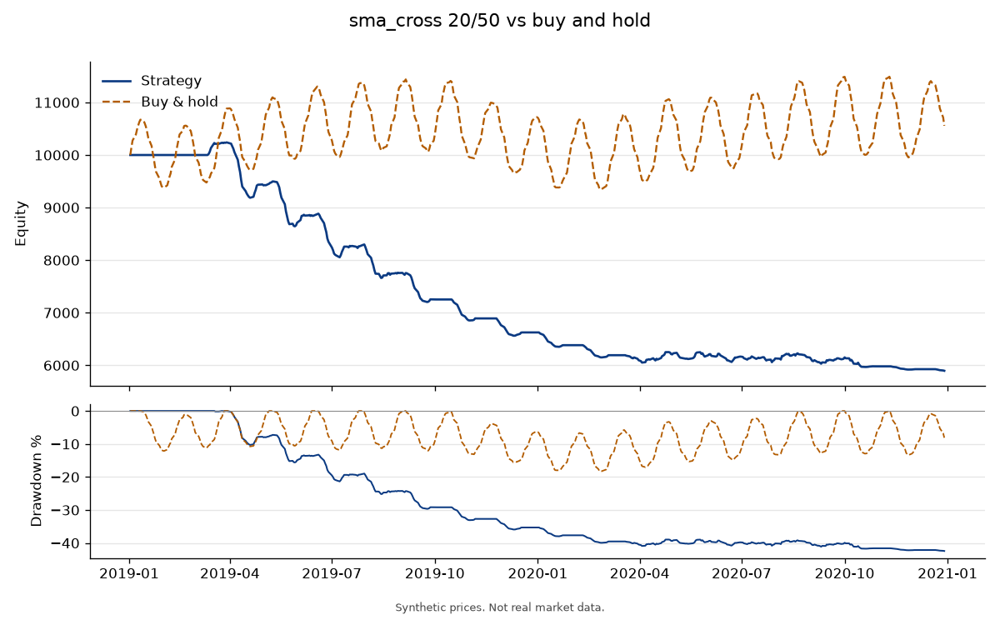

# backtester

A small Python tool that backtests a few long-only rules on daily prices.
It prints how the rule would have done next to buy-and-hold. It does not place orders, and it does not connect to a broker.

I'm Jackson Toro. I fix cars for a living and write small Python tools on the side.

Not financial advice. Educational use only.

## What it does

Three rules come with it: a simple moving-average crossover, an RSI mean-reversion rule, and buy-and-hold. You can add another by writing a small class.

The engine is deliberately plain:

- Long or flat. No shorting and no leverage.
- A signal at today's close is filled at the next session's open. Nothing trades on the first bar, and the last bar's signal has no later open to fill.
- Starting cash is split evenly across the symbols. Each symbol is traded on its own. When its signal is flat, that sleeve holds cash. Sleeves are not rebalanced against each other later, so the weights can drift.
- Commission and slippage are a flat charge in basis points on buys and sells. Both default to zero.
- Shares can be fractional. The fill is just a number in the simulation.

The table shows total return, CAGR, max drawdown, Sharpe, volatility, win rate, number of trades, and exposure. Sharpe uses daily returns, a risk-free rate of zero, and a 252-day year. Exposure is the average fraction of the portfolio that is invested. A position still open at the end is marked to the last close and counted in the win rate.

## Install

Python 3.10 or newer.

```bash
python -m venv .venv
source .venv/bin/activate
pip install -e ".[dev]"
```

`requirements.txt` lists the runtime packages if you only want those.

## Quick start

`data/synthetic_prices.csv` is made-up prices for two fake symbols, `SYN_A` and `SYN_B`. The file says so at the top. It is there so the example and the tests run with no internet. `python scripts/make_synthetic_prices.py` writes it again from a fixed seed.

```bash
python -m backtester run --csv data/synthetic_prices.csv --strategy sma_cross --fast 20 --slow 50
```

That prints the table and writes `output/equity.png`. Add `--trades-csv output/trades.csv` for the trade list. The `return` column in that file is a fraction, so `0.12` means 12%.

The chart in this README is that same run:

```bash
python -m backtester run \
  --csv data/synthetic_prices.csv \
  --strategy sma_cross \
  --fast 20 \
  --slow 50 \
  --chart docs/synthetic_sma_cross.png
```

On this file the crossover loses money. That is what the code produced. It is not a claim that the rule is good or bad. These prices are not a market.

Downloaded daily bars, cached as CSV under `cache/`:

```bash
python -m backtester run --symbols AAPL,MSFT --start 2020-01-01 --strategy sma_cross --fast 20 --slow 50
```

`--end` is inclusive. Downloaded prices are split-adjusted. The cache is one file per symbol and date range. Delete the file if you want a fresh download.

Other built-in rules are `buy_hold` and `rsi`. RSI uses Wilder's RSI, period 14, and goes long below 30 and flat above 70. Change those with `--rsi-period`, `--oversold`, and `--overbought`.

`--cash` defaults to 10000. `--commission-bps` and `--slippage-bps` default to 0.

A price CSV needs the columns `date, symbol, open, high, low, close, volume`. Lines that start with `#` are ignored.

## Example

Synthetic prices, SMA 20/50, $10,000, no costs, 2019-01-02 to 2020-12-29.

```
              sma_cross 20/50  Buy & hold
-----------------------------------------
Total return           -41.0%        5.6%
CAGR                   -23.3%        2.8%
Max drawdown           -42.4%      -18.3%
Sharpe                  -4.19        0.24
Volatility               6.1%       16.5%
Win rate                15.0%       50.0%
Trades                     20           2
Exposure                51.4%       99.8%
```



## How to add a strategy

A strategy looks at each close and returns 1 for long or 0 for flat. The number on a date may only use prices from that date and earlier. The engine buys or sells at the next open.

```python
from backtester.strategies.base import Strategy

class CloseAbove(Strategy):
    name = "close_above"

    def __init__(self, level: float):
        self.level = level

    def signals(self, prices):
        return (prices.close > self.level).astype(int)
```

Register it in `STRATEGIES` in `backtester/strategies/__init__.py`, and construct it from the CLI in `backtester/cli.py`.

## Tests

```bash
pytest
```

Tests use the synthetic file and do not download prices. GitHub Actions runs them on Python 3.10 and 3.12.

## License

MIT. See [LICENSE](LICENSE).
